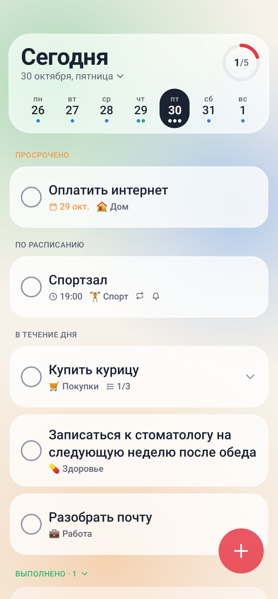
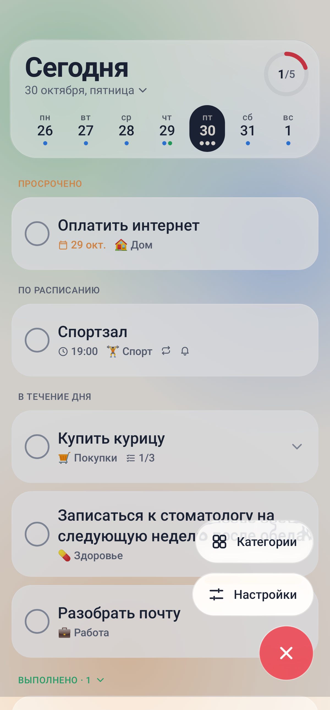
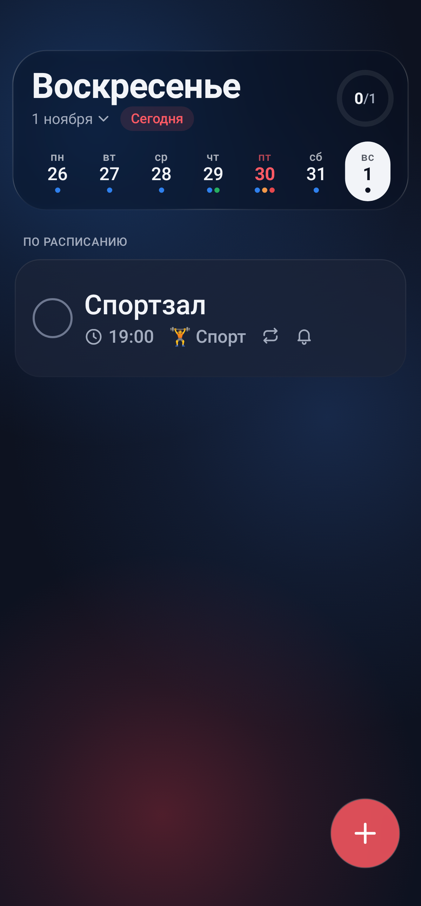

# Woody

<p>
  
  
  
</p>

**RU** — Простой ежедневник для Android: задачи на день, повторы, чек-листы и напоминания. Плавные анимации, эффект стекла, не тратит батарею в фоне. Android 12+.

**EN** — A simple daily planner for Android: daily tasks, repeats, checklists and reminders. Smooth animations, glass effect, no battery drain in the background. Android 12+.

## Сборка / Build

```powershell
.\gradlew.bat assembleRelease
```

APK: `app/build/outputs/apk/release/app-release.apk`
