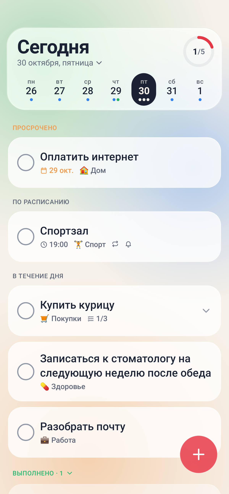
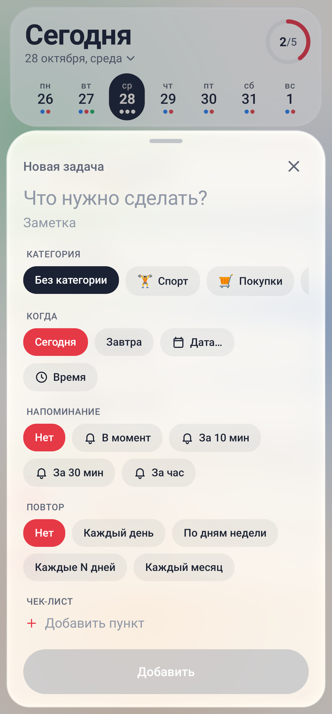
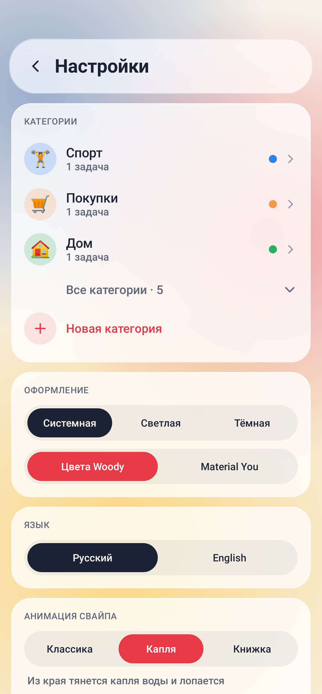
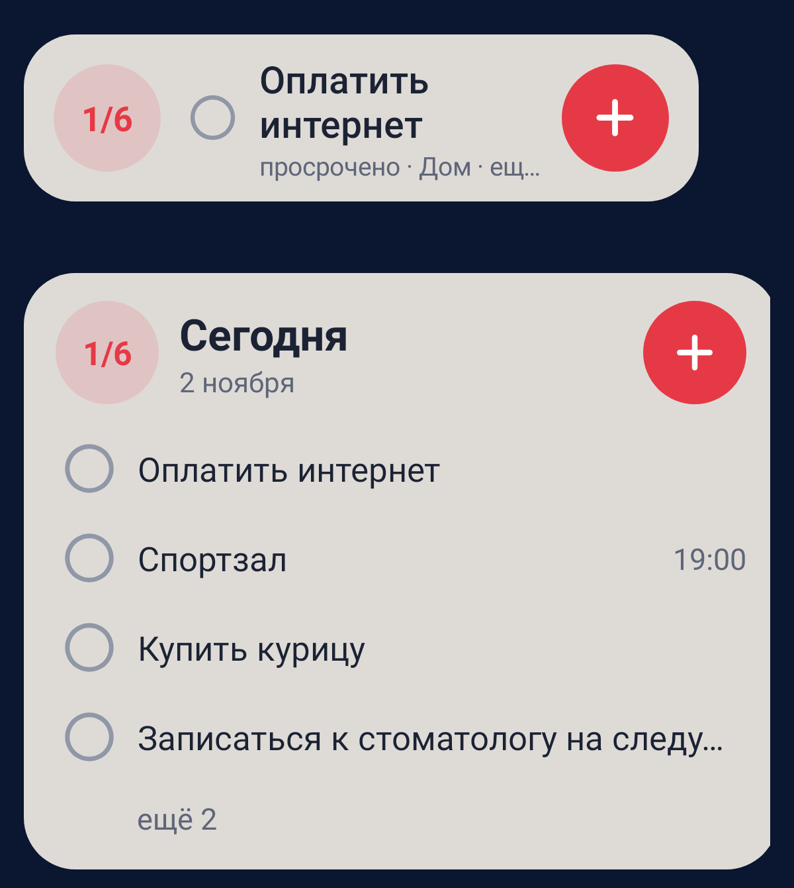

# Woody

<p>
  
  
  
</p>
<p>
  
</p>

**RU** — Простой ежедневник для Android: задачи на день, повторы, чек-листы и напоминания, виджет на рабочий стол. Пишите как говорите — «купить хлеб завтра в 18». Плавные анимации, эффект стекла, цвета Material You, не тратит батарею в фоне. Android 12+.

**EN** — A simple daily planner for Android: daily tasks, repeats, checklists, reminders and a home-screen widget. Type naturally — "buy bread tomorrow at 6pm". Smooth animations, glass effect, Material You colors, no battery drain in the background. Android 12+.

## Установка / Install

**RU** — Скачайте APK из [Releases](https://github.com/DenHaIz/Woody-ToDo/releases/latest) и установите на телефон.

**EN** — Download the APK from [Releases](https://github.com/DenHaIz/Woody-ToDo/releases/latest) and install it on your phone.

**RU** — Как пользоваться:
- Новая задача — кнопка «+» или двойное касание по пустому месту. Дату и время можно написать прямо в названии: «спортзал по понедельникам в 7 вечера».
- Свайп вправо — готово, влево — на завтра. Удержите задачу, чтобы поменять порядок или перетащить её на другой день в ленте недели.
- Виджет «Сегодня»: долгое нажатие на рабочем столе → Виджеты → Woody (5×1, можно растянуть).
- Настройки — удержите «+»: тема, цвета Material You, язык, анимация свайпа, напоминания (в том числе «Для новых задач» — напоминание сразу ставится каждой задаче со временем).

Если напоминания не приходят: Настройки (удержите «+») → «Напоминания»: включите автозапуск и «Без ограничений» (Xiaomi, Huawei, Oppo, Vivo), затем «Проверить напоминание». Язык — там же, в настройках.

**EN** — How to use:
- New task — the "+" button or a double tap on an empty spot. Put the date and time right in the title: "gym every monday at 7pm".
- Swipe right — done, left — tomorrow. Hold a task to reorder it or drag it onto another day in the week strip.
- "Today" widget: long-press the home screen → Widgets → Woody (5×1, resizable).
- Settings — hold "+": theme, Material You colors, language, swipe animation, reminders (including "For new tasks" — every task with a time gets a reminder right away).

If reminders don't arrive: Settings (hold "+") → "Reminders": enable Autostart and "Unrestricted" (Xiaomi, Huawei, Oppo, Vivo), then "Test a reminder". The app language (Russian / English) is in Settings too.

## Сборка / Build

```powershell
.\gradlew.bat assembleRelease
```

APK: `app/build/outputs/apk/release/app-release.apk`

Для разработчиков / For developers: [HANDOFF.md](HANDOFF.md)
